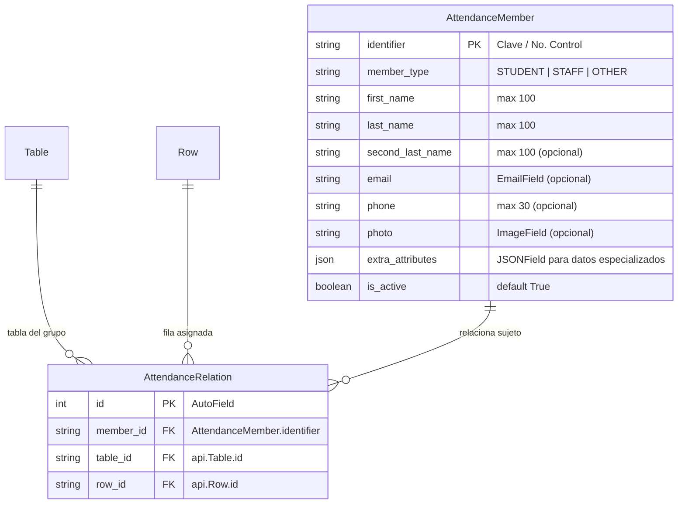
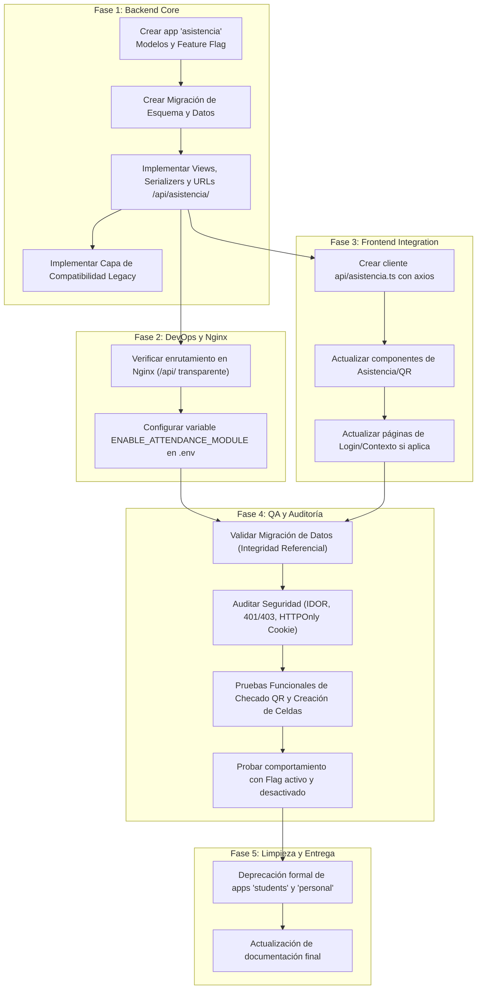

# Plan de Migración y Arquitectura: Módulo Unificado de Asistencia (`asistencia`)

**Proyecto:** Tlaix  
**Versión:** 1.0  
**Fecha:** 12 de Octubre de 2026  
**Autor:** Agente Orquestador (Project Lead & Architect)  
**Destinatarios:** Subagentes Backend, Frontend, QA y Equipo de TI / DevOps  

---

## 1. Justificación y Análisis del Estado Actual

### 1.1 Diagnóstico de la Situación Actual
Actualmente, el sistema Tlaix cuenta con dos módulos independientes que replican una lógica casi idéntica para registrar sujetos y checar asistencia en tablas dinámicas:

1. **Módulo `students` (`backend/students/`)**:
   - **Modelo `Student`**: Identificador `no_control` (CharField 14 dígitos, PK), `name`, `plantel`, `carrera` (PROGRAMACION, ELECTRONICA, DEO), `turno` (MATUTINO, VESPERTINO).
   - **Modelo `Relation`** (`db_table='relations'`): Vincula `student` (FK) con `table` (FK `Table`) y `row` (FK `Row`).
   - **Endpoint `/students/check/`**: Recibe `{"id": "<no_control>"}`. Busca la relación, crea/obtiene la pestaña `Asistencia`, crea/obtiene la columna de hoy (`YYYY-MM-DD`, tipo `checkbox`) y establece `CellValue.value_bool = True`.
   - **Endpoint `/students/upload_data/`**: Valida datos, da de alta al estudiante, crea o busca la `Table` del grupo, añade una `Row` para el alumno y crea la `Relation`.

2. **Módulo `personal` (`backend/personal/`)**:
   - **Modelo `Personal`**: Identificador `clave_empleado` (CharField 8 caracteres, PK), `nombre`, `apellido_paterno`, `apellido_materno`, `plantel`, `fecha_ingreso`, `foto`, `curp`, `telefono`, `correo`, `nivel_educativo`.
   - **Modelo `Relation`** (`db_table='personal_relations'`): Vincula `personal` (FK) con `table` (FK `Table`) y `row` (FK `Row`).
   - **Endpoint `/personal/check/`**: Recibe `{"id": "<clave_empleado>"}`. Crea/obtiene la pestaña `Asistencia`, crea dos columnas del día: `<fecha>_asistencia` (`checkbox` -> `True`) y `<fecha>_hora` (`text` -> timestamp ISO).
   - **Endpoint `/personal/upload_data/`**: Alta de empleado y vinculación con tabla y fila del grupo.

### 1.2 Problemas Identificados y Necesidad de Unificación
- **Duplicidad de Código**: Lógica redundante de vinculación con `Table` y `Row`, creación automática de pestañas y generación de `CellValue`.
- **Fallas de Enrutamiento en Producción**: Las URLs `/students/` y `/personal/` están montadas en la raíz de Django y **no están contempladas en `frontend/nginx.conf`**, lo que rompe las llamadas a través del proxy Nginx en el puerto 80.
- **Inconsistencia de Autenticación**: Ambos módulos exigen estrictamente `TokenAuthentication`, impidiendo el uso de la sesión web basada en cookies HTTPOnly (`auth_token`).
- **Falta de Modularidad**: Si un despliegue de Tlaix sólo requiere gestión tabular general (estilo Airtable/Excel) sin control de asistencias, no existe un mecanismo para desactivar estos submódulos.

---

## 2. Arquitectura Objetivo del Módulo `asistencia`

### 2.1 Principios de Diseño
1. **Unificación de Sujetos**: Una única entidad base (`Attendee` / `Member` / `Persona`) que admita distintos roles (`STUDENT`, `STAFF`, etc.) compartiendo campos comunes y atributos específicos.
2. **Ubicación Bajo Prefijo `/api/`**: Todas las rutas residirán en `/api/asistencia/`, beneficiándose de forma transparente de la directiva `location /api/` ya existente en `frontend/nginx.conf`.
3. **Activación Modular (Feature Flag)**: Control mediante variable de entorno `ENABLE_ATTENDANCE_MODULE`.
4. **Autenticación Híbrida**: Soporte unificado para HTTPOnly Cookies (Web SPA) y Tokens Bearer (Escáneres QR físicos, lectores de código de barras, apps móviles).
5. **Transición sin Ruptura**: Migración de base de datos segura que conserve todos los registros históricos existentes.

---

---

### 2.2 Modelo de Datos Unificado



#### Estructura del campo `extra_attributes` (JSONField):
- **Para Estudiantes (`member_type = 'STUDENT'`)**:
  ```json
  {
    "carrera": "PROGRAMACION",
    "turno": "MATUTINO"
  }
  ```
- **Para Personal (`member_type = 'STAFF'`)**:
  ```json
  {
    "fecha_ingreso": "2024-02-01",
    "nivel_educativo": "Licenciatura en Informática"
  }
  ```

#### Lógica de Registro de Asistencia (`check`):
Al ejecutar el checado (`POST /api/asistencia/check/`):
- Localiza al miembro y su relación con la tabla y fila asignada.
- Busca o crea la pestaña `Tab` con nombre `'Asistencia'`.
- Busca o crea la columna `Column` con la fecha actual `<YYYY-MM-DD>` (`type='checkbox'`).
- Busca o crea el valor `CellValue` en la fila del miembro y establece `value_bool = True`.

---

### 2.3 Feature Flag y Configuración (`settings.py` y `urls.py`)

#### En `backend/config/settings.py`:
```python
# Feature Flag para Módulo Opcional de Asistencia
ENABLE_ATTENDANCE_MODULE = os.environ.get('ENABLE_ATTENDANCE_MODULE', '1') == '1'

INSTALLED_APPS = [
    'guardian',
    'django.contrib.admin',
    'django.contrib.auth',
    'django.contrib.contenttypes',
    'django.contrib.sessions',
    'django.contrib.messages',
    'django.contrib.staticfiles',
    'rest_framework',
    'corsheaders',
    'rest_framework.authtoken',
    'api',
]

if ENABLE_ATTENDANCE_MODULE:
    INSTALLED_APPS.append('asistencia')
```

#### En `backend/config/urls.py`:
```python
from django.contrib import admin
from django.urls import path, include
from django.conf import settings

urlpatterns = [
    path('admin/', admin.site.urls),
    path('api/', include('api.urls')),
]

if getattr(settings, 'ENABLE_ATTENDANCE_MODULE', False):
    urlpatterns.append(path('api/asistencia/', include('asistencia.urls')))
```

---

### 2.4 Endpoints del Nuevo Módulo `/api/asistencia/`

Todas las vistas implementan:
```python
authentication_classes = [CookieTokenAuthentication, TokenAuthentication]
permission_classes = [IsAuthenticated]
```

1. **Gestión de Miembros (`AttendanceMemberViewSet`)**:
   - `GET /api/asistencia/members/`: Filtros opcionales por `?type=STUDENT`, `?search=...`.
   - `POST /api/asistencia/members/`: Creación de miembro individual.
   - `GET|PUT|PATCH|DELETE /api/asistencia/members/<identifier>/`
2. **Gestión de Relaciones (`AttendanceRelationViewSet`)**:
   - `GET|POST /api/asistencia/relations/`
   - `GET|PUT|DELETE /api/asistencia/relations/<id>/`
3. **Carga e Integración con Tablas (`/api/asistencia/upload/`)**:
   - `POST /api/asistencia/upload/`:
     - Admite carga de estudiantes o personal.
     - Registra al sujeto, localiza/crea la tabla del grupo y su fila correspondiente, e inserta la relación.
4. **Chequeo de Asistencia (`/api/asistencia/check/`)**:
   - `POST /api/asistencia/check/`:
     - Body: `{"id": "<identifier>"}`
     - Lógica: Localiza al miembro, su relación con la fila, y marca el checkbox de la fecha de hoy con `True`.

---

## 3. Estrategia de Migración de Base de Datos

Para garantizar CERO pérdida de datos, la migración se dividirá en dos pasos mediante migraciones de Django:

### Paso 1: Migración de Esquema (`0001_initial.py` en app `asistencia`)
Crea las tablas `attendance_member` y `attendance_relation`.

### Paso 2: Migración de Datos (`0002_migrate_students_and_personal.py`)
Un script de migración de datos de Django (`migrations.RunPython`) que ejecuta:

```python
def migrate_legacy_data(apps, schema_editor):
    Student = apps.get_model('students', 'Student')
    Personal = apps.get_model('personal', 'Personal')
    StudentRelation = apps.get_model('students', 'Relation')
    PersonalRelation = apps.get_model('personal', 'Relation')
    
    AttendanceMember = apps.get_model('asistencia', 'AttendanceMember')
    AttendanceRelation = apps.get_model('asistencia', 'AttendanceRelation')

    # 1. Migrar Alumnos
    for s in Student.objects.all():
        name_parts = s.name.strip().split(' ', 1)
        first_name = name_parts[0]
        last_name = name_parts[1] if len(name_parts) > 1 else ''
        
        member, _ = AttendanceMember.objects.get_or_create(
            identifier=s.no_control,
            defaults={
                'member_type': 'STUDENT',
                'first_name': first_name,
                'last_name': last_name,
                'extra_attributes': {
                    'carrera': s.carrera,
                    'turno': s.turno,
                }
            }
        )
        
    for rel in StudentRelation.objects.all():
        AttendanceRelation.objects.get_or_create(
            member_id=rel.student_id,
            table_id=rel.table_id,
            row_id=rel.row_id
        )

    # 2. Migrar Personal
    for p in Personal.objects.all():
        AttendanceMember.objects.get_or_create(
            identifier=p.clave_empleado,
            defaults={
                'member_type': 'STAFF',
                'first_name': p.nombre,
                'last_name': p.apellido_paterno,
                'second_last_name': p.apellido_materno,
                'email': p.correo,
                'phone': p.telefono,
                'photo': p.foto,
                'extra_attributes': {
                    'fecha_ingreso': str(p.fecha_ingreso),
                    'nivel_educativo': p.nivel_educativo
                }
            }
        )
        
    for rel in PersonalRelation.objects.all():
        AttendanceRelation.objects.get_or_create(
            member_id=rel.personal_id,
            table_id=rel.table_id,
            row_id=rel.row_id
        )
```

### Paso 3: Retiro de Modelos Legados
Una vez que QA verifique la integridad y el funcionamiento de la nueva app `asistencia`:
- Se desinstalan las apps `students` y `personal` de `INSTALLED_APPS`.
- Se ejecutan migraciones de eliminación de tablas antiguas o se archivan en base de datos.

---

## 4. Fases de Ejecución y Asignación de Subagentes



### Detalle de Tareas por Subagente:

#### 🧑‍💻 Subagente `backend`:
1. Inicializar la app `backend/asistencia/`.
2. Crear los modelos `AttendanceMember` y `AttendanceRelation` en `asistencia/models.py`.
3. Configurar el Feature Flag `ENABLE_ATTENDANCE_MODULE` en `config/settings.py` y `config/urls.py`.
4. Diseñar la migración de datos de `students` y `personal` hacia `asistencia`.
5. Desarrollar serializadores y vistas para miembros, relaciones, upload y check.
6. Habilitar autenticación híbrida (`CookieTokenAuthentication` + `TokenAuthentication`).
7. Desarrollar suite de pruebas unitarias (`backend/asistencia/tests.py`).

#### 🎨 Subagente `frontend`:
1. Crear el módulo `src/api/asistencia.ts` integrando llamadas con `withCredentials: true`.
2. Actualizar las referencias del cliente web para consumir `/api/asistencia/check/` y `/api/asistencia/members/`.
3. Ajustar componentes visuales o diálogos que cargan datos de asistencia.

#### 🛡️ Subagente `qa`:
1. Ejecutar verificación de integridad en PostgreSQL tras la migración de datos (comprobar que la suma de alumnos y empleados coincide con los registros en `AttendanceMember`).
2. Comprobar que todas las celdas asociadas a las filas existentes en Tlaix siguen correspondiendo al sujeto correcto.
3. Probar checado QR con credenciales de prueba y validar que se creen las columnas de fecha y valores booleanos/timestamps.
4. Auditar seguridad: Verificar que solicitudes no autenticadas sean rechazadas con `401 Unauthorized` y accesos indebidos con `403 Forbidden`.
5. Probar el encendido y apagado de `ENABLE_ATTENDANCE_MODULE` (asegurar que con `0` el sistema de tablas funciona perfectamente sin errores 500).

---

## 5. Criterios de Aceptación y Checklist de Salida a Producción

| Criterio | Verificación | Responsable |
| :--- | :--- | :--- |
| **Persistencia de Datos** | Todos los registros previos de `students` y `personal` existen en `attendance_member` sin pérdida de atributos. | Backend / QA |
| **Integridad de Celdas** | Las tablas y filas vinculadas en Tlaix mantienen sus relaciones intactas (`relation.row` y `relation.table`). | QA |
| **Enrutamiento Nginx** | `/api/asistencia/*` responde correctamente a través del puerto 80 del contenedor frontend sin ser interceptado por la SPA. | DevOps / QA |
| **Soporte de Cookies** | Un usuario logueado en la aplicación web puede ejecutar peticiones de asistencia utilizando su cookie HTTPOnly. | QA / Frontend |
| **Soporte de Tokens** | Clientes sin navegador (lectores QR) pueden checar asistencia enviando cabecera `Authorization: Token <key>`. | QA / Backend |
| **Feature Flag Funcional** | Cuando `ENABLE_ATTENDANCE_MODULE=0`, el servidor inicia limpiamente, `/api/asistencia/` retorna 404 y el core de tablas opera al 100%. | Backend / QA |
| **Tests Automatizados** | Suite de tests en Django (`manage.py test asistencia`) aprobada al 100% con tests de permisos, tipado y checado. | Backend |

---

*Fin del Plan de Migración. Aprobado para ejecución y distribución al equipo técnico.*
