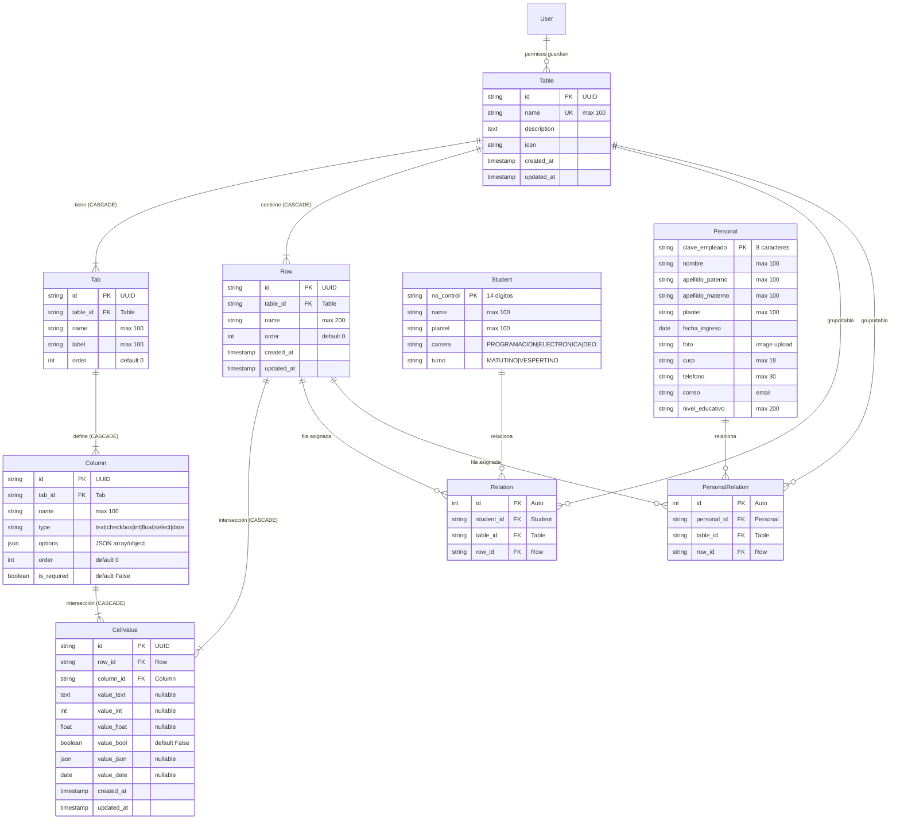

# Especificación Técnica y Documentación Integral del Sistema Tlaix

**Versión:** 1.0.0  
**Fecha de Auditoría:** 11 de Octubre de 2026  
**Rol del Documento:** Referencia Oficial de Arquitectura, API, QA y Operaciones TI  
**Entorno de Trabajo:** Monorrepositorio Dockerizado (Django REST Framework + React SPA + PostgreSQL 15)

---

## Índice General
1. [Resumen Ejecutivo y Visión General](#1-resumen-ejecutivo-y-visión-general)
2. [Arquitectura del Monorrepositorio y Tecnologías](#2-arquitectura-del-monorrepositorio-y-tecnologías)
3. [Modelo de Datos y Entidades (ER)](#3-modelo-de-datos-y-entidades-er)
4. [Catálogo Exhaustivo de Endpoints de la API](#4-catálogo-exhaustivo-de-endpoints-de-la-api)
   - [4.1 Módulo de Autenticación y Usuarios (`/api/user/`, `/api/clients/`)](#41-módulo-de-autenticación-y-usuarios)
   - [4.2 Módulo de Tablas Dinámicas (`/api/tables/`)](#42-módulo-de-tablas-dinámicas)
   - [4.3 Módulo de Pestañas (`/api/tables/<table_id>/tabs/`)](#43-módulo-de-pestañas)
   - [4.4 Módulo de Columnas (`/api/tables/<table_id>/columns/`)](#44-módulo-de-columnas)
   - [4.5 Módulo de Filas (`/api/tables/<table_id>/rows/`)](#45-módulo-de-filas)
   - [4.6 Módulo de Celdas Normalizadas (`/api/tables/cell/`)](#46-módulo-de-celdas-normalizadas)
   - [4.7 Endpoint Optimizado TabView (`/api/tables/tabview/`)](#47-endpoint-optimizado-tabview)
   - [4.8 Módulo de Estudiantes y Asistencia QR (`/students/`)](#48-módulo-de-estudiantes-y-asistencia-qr)
   - [4.9 Módulo de Personal y Registro Biométrico/Horario (`/personal/`)](#49-módulo-de-personal-y-registro-biométricohorario)
5. [Estrategia de Autenticación, Seguridad y Permisos](#5-estrategia-de-autenticación-seguridad-y-permisos)
6. [Variables de Entorno y Configuración](#6-variables-de-entorno-y-configuración)
7. [Despliegue y Consideraciones para TI / DevOps](#7-despliegue-y-consideraciones-para-ti--devops)
8. [Matriz de Pruebas y Consideraciones para QA](#8-matriz-de-pruebas-y-consideraciones-para-qa)
9. [Hallazgos Críticos, Inconsistencias y Plan de Acción (TODO)](#9-hallazgos-críticos-inconsistencias-y-plan-de-acción-todo)

---

## 1. Resumen Ejecutivo y Visión General
**Tlaix** es una plataforma orientada a la creación, estructuración y manipulación de datos tabulares dinámicos (estilo hoja de cálculo/Airtable/Excel) con control de acceso por objeto y módulos especializados para el control escolar de alumnos y registro de asistencia/horarios de personal.

### Componentes Principales
- **Backend Core**: Desarrollado en Python 3.11/3.12 con **Django 5+** y **Django REST Framework (DRF)**. Implementa seguridad basada en objetos vía **django-guardian** y autenticación híbrida (HTTPOnly Cookies + Tokens Bearer).
- **Frontend SPA**: Desarrollado en **React 18** con **TypeScript**, empaquetado con **Vite**, estilizado con **Tailwind CSS** y componentes de **shadcn/ui (Radix UI)**, con gestión de peticiones mediante **TanStack React Query** y **Axios**.
- **Infraestructura de Datos**: **PostgreSQL 15** persistido en volúmenes Docker.
- **Servidor Web y Reverse Proxy**: **Nginx** en contenedor frontend, con perfiles opcionales para **Nginx Proxy Manager** y **Cloudflare Tunnel**.

---

## 2. Arquitectura del Monorrepositorio y Tecnologías

### 2.1 Estructura del Proyecto
```
d:\Documents\Proyectos\Tlaix\
├── docker-compose.yml          # Orquestación de contenedores (db, django, react, npm, cloudflare)
├── .env.example                # Plantilla de variables de entorno
├── README.md                   # Instrucciones base de despliegue
├── TODO.md                     # Roadmap técnico
├── HTTPONLY_COOKIES_MIGRATION.md # Historial y guía de cookies seguras
│
├── backend/                    # Servidor API Django
│   ├── Dockerfile              # Basado en python:3.11-slim
│   ├── entrypoint.sh           # Script de arranque (migrate + collectstatic + gunicorn)
│   ├── manage.py
│   ├── config/                 # Configuración raíz de Django
│   │   ├── settings.py         # Configuración DRF, CORS, Guardian, BD, Cookies
│   │   ├── urls.py             # Enrutador principal (/admin/, /api/, /students/, /personal/)
│   │   └── wsgi.py
│   ├── api/                    # Aplicación de Tablas Dinámicas y Auth
│   │   ├── models.py           # Table, Tab, Column, Row, CellValue
│   │   ├── serializers.py      # Serializadores DRF
│   │   ├── views.py            # ViewSets y vistas API
│   │   ├── urls.py             # Rutas /api/
│   │   ├── permissions.py      # CookieTokenAuthentication, CompleteDjangoObjectPermissions
│   │   └── tests.py            # Cobertura de permisos y validaciones de tipos
│   ├── students/               # Submódulo de Alumnos
│   │   ├── models.py           # Student, Relation
│   │   ├── views.py            # StudentViewSet, RelationViewSet, upload_data, check
│   │   └── urls.py             # Rutas /students/
│   └── personal/               # Submódulo de Personal/Plantel
│       ├── models.py           # Personal, Relation
│       ├── views.py            # PersonalViewSet, RelationViewSet, upload_data, check
│       └── urls.py             # Rutas /personal/
│
├── frontend/                   # Cliente Web SPA
│   ├── Dockerfile              # Multi-stage (node:26-alpine -> nginx:stable-alpine)
│   ├── nginx.conf              # Reverse proxy Nginx para / y /api/
│   ├── package.json            # React, TypeScript, Vite, Tailwind, Radix UI
│   ├── vite.config.ts
│   └── src/
│       ├── api/                # Clientes API Axios (users, tables, tabs, rows, columns, cells)
│       ├── components/         # UI Components (shadcn/ui, Header, AddColumnDialog, etc.)
│       ├── context/            # AuthContext (Gestión de sesión HTTPOnly)
│       └── pages/              # Index, TableView, Login, ApiDocumentation, NotFound
│
├── db/                         # [LEGACY] Archivos históricos MySQL (db.sql, Dockerfile)
└── scripts/                    # Scripts auxiliares y repositorio de códigos QR generados
    └── qrs/                    # QR PNGs para testing de asistencia
```

---

## 3. Modelo de Datos y Entidades (ER)

El núcleo del sistema utiliza una base de datos relacional PostgreSQL con una arquitectura de datos dinámicos basada en entidad-atributo-valor (EAV) optimizada por tipos:



### Reglas Clave del Modelo:
1. **Unicidad**:
   - `Table.name`: Único globalmente.
   - `Tab`: Único par `[table, name]`.
   - `Column`: Único par `[tab, name]`.
   - `CellValue`: Único par `[row, column]` (garantiza una sola celda por intersección).
   - `Relation`: Único trío `[student, table, row]` y `[personal, table, row]`.
2. **Normalización de Celdas (`CellValue`)**:
   Los valores se persisten en campos tipados (`value_text`, `value_int`, `value_float`, `value_bool`, `value_json`, `value_date`). El modelo y el serializador manejan de manera polimórfica la lectura y escritura mediante los métodos `.get_value()` y `.set_value()`.

---

## 4. Catálogo Exhaustivo de Endpoints de la API

### 4.1 Módulo de Autenticación y Usuarios

#### 1. Iniciar Sesión (Web SPA - Cookies HTTPOnly)
- **Método**: `POST`
- **Ruta**: `/api/user/login/`
- **Controlador**: `api.views.login`
- **Autenticación**: Pública (`AllowAny`)
- **Body Esperado**:
  ```json
  {
    "email": "usuario@ejemplo.com",
    "password": "tu_password"
  }
  ```
- **Respuesta Exitosa (200 OK)**:
  - **Headers**: `Set-Cookie: auth_token=<token_key>; HttpOnly; SameSite=Lax; Path=/; Max-Age=604800`
  - **Body**:
    ```json
    {
      "user": {
        "id": 1,
        "username": "admin",
        "email": "usuario@ejemplo.com"
      }
    }
    ```
- **Errores Posibles**:
  - `400 Bad Request`: `{"error": "Email and password are required"}`
  - `401 Unauthorized`: `{"error": "Invalid password"}`
  - `404 Not Found`: No existe usuario registrado con ese email.

#### 2. Iniciar Sesión (Clientes Externos / Desktop / Mobile)
- **Método**: `POST`
- **Ruta**: `/api/clients/login/`
- **Controlador**: `api.views.login_clients`
- **Autenticación**: Pública (`AllowAny`)
- **Descripción**: Diseñado para clientes que no soportan o no almacenan cookies en el navegador. Devuelve el token directamente en el cuerpo JSON.
- **Body Esperado**:
  ```json
  {
    "email": "usuario@ejemplo.com",
    "password": "tu_password"
  }
  ```
- **Respuesta Exitosa (200 OK)**:
  ```json
  {
    "token": "9944b09199c62bcf9418ad846dd0e4bbdfc6ee4b"
  }
  ```

#### 3. Registro de Usuario
- **Método**: `POST`
- **Ruta**: `/api/user/register/`
- **Controlador**: `api.views.register`
- **Autenticación**: Pública (`AllowAny`)
- **Body Esperado**:
  ```json
  {
    "username": "nuevo_usuario",
    "email": "nuevo@ejemplo.com",
    "password": "Password123!"
  }
  ```
- **Respuesta Exitosa (201 Created)**:
  ```json
  {
    "token": "9944b09199c62bcf9418ad846dd0e4bbdfc6ee4b"
  }
  ```
- **Errores**: `400 Bad Request` con el detalle de validación de campos.

#### 4. Obtener Perfil del Usuario Autenticado
- **Método**: `GET`
- **Ruta**: `/api/user/`
- **Controlador**: `api.views.user`
- **Autenticación**: Requerida (`CookieTokenAuthentication` o `Token <token>`)
- **Respuesta Exitosa (200 OK)**:
  ```json
  {
    "id": 1,
    "username": "admin",
    "email": "admin@tlaix.local"
  }
  ```
- **Errores**: `401 Unauthorized`.

#### 5. Cerrar Sesión
- **Método**: `POST`
- **Ruta**: `/api/user/logout/`
- **Controlador**: `api.views.logout`
- **Autenticación**: Requerida (`IsAuthenticated`)
- **Acción**: Elimina el token de la base de datos y envía cabecera para expirar la cookie `auth_token`.
- **Respuesta Exitosa (200 OK)**:
  ```json
  {
    "message": "Logout successful"
  }
  ```

---

### 4.2 Módulo de Tablas Dinámicas

**Base:** `/api/tables/`  
**Controlador:** `api.views.TableViewSet`  
**Seguridad:** `[IsAuthenticated, CompleteDjangoObjectPermissions]` con `django-guardian`.

#### 1. Listar Tablas Permitidas
- **Método**: `GET`
- **Ruta**: `/api/tables/`
- **Descripción**: Devuelve únicamente las tablas sobre las que el usuario autenticado tiene el permiso de objeto `api.view_table`. Si no tiene permiso en ninguna, devuelve una lista vacía `[]`.
- **Respuesta (200 OK)**:
  ```json
  [
    {
      "id": "c1f54cf2-ef84-48bc-bce1-fa1eb31a8479",
      "name": "Grupo 101",
      "description": "Lista de alumnos del grupo 101",
      "icon": "Database",
      "created_at": "2026-10-11T12:00:00Z",
      "updated_at": "2026-10-11T12:00:00Z"
    }
  ]
  ```

#### 2. Crear Nueva Tabla
- **Método**: `POST`
- **Ruta**: `/api/tables/`
- **Permisos requeridos**: Requiere permiso global `api.add_table`.
- **Efecto colateral**: Asigna de forma automática al usuario creador los permisos de objeto `add_table`, `change_table`, `delete_table` y `view_table` sobre la instancia creada.
- **Body Esperado**:
  ```json
  {
    "name": "Inventario 2026",
    "description": "Control de bienes del plantel",
    "icon": "Package"
  }
  ```
- **Respuesta (201 Created)**: Objeto de la tabla creada.
- **Errores**: `403 Forbidden` si no cuenta con el permiso `add_table`.

#### 3. Detalle de Tabla
- **Método**: `GET`
- **Ruta**: `/api/tables/<pk>/`
- **Permisos requeridos**: Permiso de objeto `view_table`. Si no cuenta con él, devuelve `404 Not Found` (para no revelar la existencia de la tabla).
- **Respuesta (200 OK)**: Objeto tabla.

#### 4. Actualizar Tabla
- **Método**: `PUT` / `PATCH`
- **Ruta**: `/api/tables/<pk>/`
- **Permisos requeridos**: `view_table` y `change_table` sobre la tabla.
- **Respuesta (200 OK)**: Objeto tabla actualizado.

#### 5. Eliminar Tabla
- **Método**: `DELETE`
- **Ruta**: `/api/tables/<pk>/`
- **Permisos requeridos**: `view_table` y `delete_table` sobre la tabla.
- **Respuesta (204 No Content)**.

#### 6. Carga Masiva de Pestañas y Filas en Lote (Bulk Upload)
- **Método**: `POST`
- **Ruta**: `/api/tables/<table_id>/bulk/`
- **Controlador**: `api.views.TableBulkUploadView`
- **Seguridad**: `[IsAuthenticated, CookieTokenAuthentication, TokenAuthentication]`
- **Permisos requeridos**:
  - Permiso sobre la tabla: `change_table`, `add_table` o `view_table` (o superusuario).
  - Si incluye `tabs`: Permiso global `api.add_tab` (o superusuario).
  - Si incluye `rows`: Permiso global `api.add_row` (o superusuario).
- **Descripción**: Permite subir múltiples pestañas y/o filas en una sola transacción atómica (`transaction.atomic()`). Asigna automáticamente al usuario los permisos de objeto guardian (`add_tab`, `change_tab`, `delete_tab`, `view_tab`) sobre cada pestaña creada. Calcula de forma incremental el orden de visualización de pestañas y filas si no se especifica. Admite elementos tanto en formato simplificado (cadena con nombre) como en formato objeto detallado. Si las filas incluyen diccionario `data`, genera o actualiza los `CellValue` correspondientes a las columnas de la tabla.
- **Body Esperado (JSON)**:
  ```json
  {
    "tabs": [
      {
        "name": "General",
        "label": "Vista Principal",
        "order": 0
      },
      "Seguimiento"
    ],
    "rows": [
      {
        "name": "Juan Pérez",
        "order": 0,
        "data": {
          "column_uuid_here": "Valor celda"
        }
      },
      "María García"
    ]
  }
  ```
- **Respuesta (201 Created)**:
  ```json
  {
    "message": "Carga masiva completada exitosamente.",
    "tabs_count": 2,
    "rows_count": 2,
    "tabs": [
      {
        "id": "tab-uuid-1",
        "table": "table-uuid",
        "name": "General",
        "label": "Vista Principal",
        "order": 0
      },
      {
        "id": "tab-uuid-2",
        "table": "table-uuid",
        "name": "Seguimiento",
        "label": "Seguimiento",
        "order": 1
      }
    ],
    "rows": [
      {
        "id": "row-uuid-1",
        "table": "table-uuid",
        "name": "Juan Pérez",
        "order": 0,
        "data": {
          "column_uuid_here": "Valor celda"
        },
        "created_at": "2026-10-11T17:00:00Z",
        "updated_at": "2026-10-11T17:00:00Z"
      },
      {
        "id": "row-uuid-2",
        "table": "table-uuid",
        "name": "María García",
        "order": 1,
        "data": {},
        "created_at": "2026-10-11T17:00:00Z",
        "updated_at": "2026-10-11T17:00:00Z"
      }
    ]
  }
  ```
- **Errores Posibles**:
  - `400 Bad Request`: Payload sin campos `tabs` ni `rows`, nombre en blanco o nombre de pestaña duplicado en la tabla.
  - `401 Unauthorized`: Usuario no autenticado.
  - `403 Forbidden`: Sin permisos sobre la tabla, o sin permisos para crear pestañas/filas.
  - `404 Not Found`: Si la tabla no existe.

---


### 4.3 Módulo de Pestañas (Tabs)

**Base:** `/api/tables/<table_id>/tabs/`  
**Controlador:** `api.views.TabViewSet`  
**Seguridad:** `[IsAuthenticated, CompleteDjangoObjectPermissions]`

#### 1. Listar Pestañas de una Tabla
- **Método**: `GET`
- **Ruta**: `/api/tables/<table_id>/tabs/`
- **Descripción**: Filtra las pestañas de la tabla especificada en las que el usuario posee permiso de objeto `api.view_tab`. Requiere además que el usuario tenga acceso `view_table` a la tabla contenedora.
- **Respuesta (200 OK)**:
  ```json
  [
    {
      "id": "e932bce1-d729-450a-8bf8-d8f99e3a35b1",
      "table": "c1f54cf2-ef84-48bc-bce1-fa1eb31a8479",
      "name": "General",
      "label": "Datos Generales",
      "order": 0
    }
  ]
  ```

#### 2. Crear Pestaña
- **Método**: `POST`
- **Ruta**: `/api/tables/<table_id>/tabs/`
- **Permisos requeridos**: Permiso global `add_tab` y permiso sobre la tabla `add_table`. Otorga al creador los permisos de objeto `view_tab`, `change_tab`, `delete_tab`, `add_tab`.
- **Body Esperado**:
  ```json
  {
    "name": "asistencia",
    "label": "Asistencia Mensual",
    "order": 1
  }
  ```
- **Respuesta (201 Created)**: Objeto de la pestaña.

#### 3. Detalle, Actualización y Eliminación
- **Rutas**:
  - `GET /api/tables/<table_id>/tabs/<pk>/` (200 OK)
  - `PUT /api/tables/<table_id>/tabs/<pk>/` (200 OK)
  - `DELETE /api/tables/<table_id>/tabs/<pk>/` (204 No Content)
- **Permisos**: Requiere permisos granulares a nivel de objeto `view_tab`, `change_tab` y `delete_tab` correspondientemente.

---

### 4.4 Módulo de Columnas

**Base:** `/api/tables/<table_id>/columns/`  
**Controlador:** `api.views.ColumnViewSet`  
**Seguridad:** `[IsAuthenticated, DjangoModelPermissions]`

#### 1. Listar Columnas de una Tabla
- **Método**: `GET`
- **Ruta**: `/api/tables/<table_id>/columns/`
- **Descripción**: Retorna todas las columnas asociadas a pestañas visibles para el usuario en la tabla. Si el usuario es superusuario, devuelve todas las columnas.
- **Respuesta (200 OK)**:
  ```json
  [
    {
      "id": "f51a4f02-a1b2-4c3d-8e4f-5a6b7c8d9e0f",
      "table_id": "c1f54cf2-ef84-48bc-bce1-fa1eb31a8479",
      "tab_id": "e932bce1-d729-450a-8bf8-d8f99e3a35b1",
      "name": "Fecha de Nacimiento",
      "type": "date",
      "options": null,
      "order": 0,
      "is_required": false
    }
  ]
  ```

#### 2. Crear Columna
- **Método**: `POST`
- **Ruta**: `/api/tables/<table_id>/columns/`
- **Comportamiento Automático**: Si el campo `tab_id` no viene en el body, el backend localiza la primera pestaña de la tabla o crea automáticamente una pestaña `"General"` (`order=0`).
- **Body Esperado**:
  ```json
  {
    "name": "Estatus",
    "type": "select",
    "tab_id": "e932bce1-d729-450a-8bf8-d8f99e3a35b1",
    "options": ["Activo", "Inactivo", "Baja"],
    "order": 1,
    "is_required": true
  }
  ```
- **Tipos de Columna Soportados (`type`)**:
  - `text`: Texto abierto.
  - `checkbox`: Booleano (`true`/`false`).
  - `int`: Número entero.
  - `float`: Número con punto flotante / decimal.
  - `select`: Selección única o múltiple (admite `options`).
  - `date`: Fecha en formato ISO (`YYYY-MM-DD`).
- **Respuesta (201 Created)**: Objeto columna creado.

#### 3. Detalle, Edición y Eliminación
- `GET /api/tables/<table_id>/columns/<pk>/`
- `PUT /api/tables/<table_id>/columns/<pk>/`
- `DELETE /api/tables/<table_id>/columns/<pk>/`

---

### 4.5 Módulo de Filas

**Base:** `/api/tables/<table_id>/rows/`  
**Controlador:** `api.views.RowViewSet`  
**Seguridad:** `[IsAuthenticated, DjangoModelPermissions]`

#### 1. Listar Filas
- **Método**: `GET`
- **Ruta**: `/api/tables/<table_id>/rows/`
- **Descripción**: Lista las filas de la tabla. Al serializar, el backend inyecta dinámicamente un objeto `data` con la clave-valor de todas las celdas asociadas (`{ column_id: valor }`).
- **Respuesta (200 OK)**:
  ```json
  [
    {
      "id": "row-77b3",
      "table": "c1f54cf2-ef84-48bc-bce1-fa1eb31a8479",
      "name": "Pérez Juan",
      "order": 0,
      "data": {
        "f51a4f02-a1b2-4c3d-8e4f-5a6b7c8d9e0f": "2005-04-12",
        "col-uuid-2": true
      },
      "created_at": "2026-10-11T12:00:00Z",
      "updated_at": "2026-10-11T12:00:00Z"
    }
  ]
  ```

#### 2. Crear Fila
- **Método**: `POST`
- **Ruta**: `/api/tables/<table_id>/rows/`
- **Body Esperado**:
  ```json
  {
    "name": "López María",
    "order": 1,
    "data": {
      "f51a4f02-a1b2-4c3d-8e4f-5a6b7c8d9e0f": "2006-08-20"
    }
  }
  ```
- **Comportamiento**: Crea la fila y, si se proporcionan columnas en `data`, crea/actualiza los registros en `CellValue`.
- **`order` automático (desde 2026-10-19)**: si el cliente **omite** `order`, el backend asigna `(max order de la tabla) + 1` (o `0` si la tabla no tiene filas). Antes todas las filas creadas por la UI quedaban en `order=0` y empataban entre sí. Si el cliente envía `order` explícito, se respeta tal cual; la carga masiva (`TableBulkUploadView`) no cambia su comportamiento.
- **Respuesta (201 Created)**: Objeto fila (incluye el `order` efectivamente asignado).

#### 3. Detalle, Modificación y Eliminación
- `GET /api/tables/<table_id>/rows/<pk>/`
- `PUT /api/tables/<table_id>/rows/<pk>/`
- `DELETE /api/tables/<table_id>/rows/<pk>/`

---

### 4.6 Módulo de Celdas Normalizadas

**Ruta:** `/api/tables/cell/<table_id>/<column_id>/<row_id>/`  
**Controlador:** `api.views.CellValueViewSet`  
**Seguridad:** `[IsAuthenticated, DjangoModelPermissions]`

#### 1. Obtener Valor de Celda
- **Método**: `GET`
- **Ruta**: `/api/tables/cell/<table_id>/<column_id>/<row_id>/`
- **Respuesta (200 OK)**:
  ```json
  {
    "id": "cell-912a",
    "row_id": "row-77b3",
    "column_id": "f51a4f02-a1b2-4c3d-8e4f-5a6b7c8d9e0f",
    "value": "2005-04-12",
    "created_at": "2026-10-11T12:00:00Z",
    "updated_at": "2026-10-11T12:00:00Z"
  }
  ```

#### 2. Crear o Actualizar Celda (Upsert en PUT)
- **Método**: `PUT` (Recomendado para la UI) o `POST`
- **Ruta**: `/api/tables/cell/<table_id>/<column_id>/<row_id>/`
- **Comportamiento Crítico**: En el método `PUT`, si el registro `CellValue` no existe aún en la base de datos, **lo crea automáticamente** (upsert).
- **Validación Estricta de Tipos**: El serializador valida que el valor sea coherente con la columna:
  - `text`: Requiere string.
  - `checkbox`: Requiere booleano (`true`/`false`).
  - `int`/`float`: Requiere valor numérico.
  - `select`: Requiere string, lista o diccionario.
  - `date`: Requiere formato ISO `YYYY-MM-DD`. De lo contrario lanza `400 Bad Request`.
- **Body Esperado**:
  ```json
  {
    "value": "2026-10-15"
  }
  ```
- **Respuesta**: `200 OK` (actualizado) o `201 Created` (creado).

#### 3. Eliminar Valor de Celda
- **Método**: `DELETE`
- **Ruta**: `/api/tables/cell/<table_id>/<column_id>/<row_id>/`
- **Respuesta (204 No Content)**.

---

### 4.7 Endpoint Optimizado TabView

**Ruta:** `/api/tables/tabview/<table_id>/<tab_id>/`  
**Controlador:** `api.views.TabView` (APIView)  
**Seguridad:** `[IsAuthenticated, CompleteDjangoObjectPermissions]`

#### Descripción y Arquitectura
Es el endpoint principal utilizado por el frontend para renderizar la cuadrícula interactiva tipo Excel. Resuelve el problema de consultas $N+1$ ejecutando una única consulta acotada al lote solicitado con `.select_related('column')` y mapeando los valores en memoria en una matriz bidimensional indexada.

**Paginación (desde 2026-10-19):** el endpoint pagina filas y columnas en el servidor. Sin parámetros devuelve el primer lote de 50 filas y 100 columnas. El costo de la consulta es $O(\text{limit})$ en lugar de $O(\text{total})$, y las celdas solo se consultan para el lote de filas/columnas devuelto.

- **Método**: `GET`
- **Parámetros de Ruta**: `table_id` (UUID), `tab_id` (UUID)
- **Parámetros de Query (opcionales)**:

  | Parámetro | Tipo | Default | Máximo | Descripción |
  | --- | --- | --- | --- | --- |
  | `row_limit` | int \| `all` | `50` | `500` | Filas por lote. `all` o `0` devuelve todas (modo no paginado, para exportaciones). |
  | `row_offset` | int | `0` | — | Filas a omitir antes del lote. |
  | `col_limit` | int \| `all` | `100` | `500` | Columnas por lote. `all` o `0` devuelve todas. |
  | `col_offset` | int | `0` | — | Columnas a omitir antes del lote. |

  Valores no numéricos o negativos caen a los defaults; los límites mayores al máximo se recortan.

- **Orden determinista (desde 2026-10-19)**: las filas se ordenan explícitamente por `order`, `created_at`, `id`. El desempate evita que, cuando varias filas comparten `order` (p. ej. `0`), Postgres devuelva un orden físico distinto entre consultas y la paginación por bloques (`row_offset`) salte filas. Recorrer todo el conjunto con lotes sucesivos devuelve cada fila exactamente una vez.
- **Permisos**: Verifica permiso `view_table` sobre la tabla y `view_tab` sobre la pestaña.
- **Respuesta (200 OK)**:
  ```json
  {
    "tab": {
      "id": "e932bce1-d729-450a-8bf8-d8f99e3a35b1",
      "table": "c1f54cf2-ef84-48bc-bce1-fa1eb31a8479",
      "name": "General",
      "label": "Datos Generales",
      "order": 0
    },
    "pagination": {
      "total_rows": 350,
      "row_limit": 50,
      "row_offset": 0,
      "has_more_rows": true,
      "total_columns": 12,
      "col_limit": 100,
      "col_offset": 0,
      "has_more_columns": false
    },
    "columns": [
      {
        "id": "col-uuid-1",
        "name": "Nombre Completo",
        "type": "text",
        "options": null,
        "order": 0,
        "is_required": true
      },
      {
        "id": "col-uuid-2",
        "name": "Asistencia Hoy",
        "type": "checkbox",
        "options": null,
        "order": 1,
        "is_required": false
      }
    ],
    "rows": [
      {
        "id": "row-uuid-101",
        "name": "Hernández Juan",
        "order": 0,
        "cells": {
          "col-uuid-1": "Hernández Juan",
          "col-uuid-2": true
        }
      }
    ]
  }
  ```

- **Ejemplo de siguiente lote**: `GET /api/tables/tabview/<table_id>/<tab_id>/?row_limit=50&row_offset=50`
- **Frontend**: `TableView.tsx` usa `IntersectionObserver` (`root: null`) sobre un centinela al final de la tabla, dentro del contenedor original `<div className="overflow-x-auto">`; el desplazamiento vertical es el de la página y se concatenan lotes de 50 filas. Solo se añade un indicador "Cargando más filas..." mientras llega el bloque.
- **Compatibilidad**: clientes que no envían parámetros reciben un lote seguro de 50 filas más el bloque `pagination`; para obtener todo el contenido deben enviar `row_limit=all` (y `col_limit=all` si la pestaña supera 100 columnas).

---

### 4.8 Módulo de Estudiantes y Asistencia QR

**Prefijo Base:** `/students/`  
**Controlador:** `students.views.*`  
**Autenticación:** `[TokenAuthentication]`, `IsAuthenticated`

#### 1. CRUD de Estudiantes
- `GET /students/`: Listado de todos los estudiantes.
- `POST /students/`: Crear estudiante (`no_control`, `name`, `plantel`, `carrera`, `turno`).
- `GET /students/<no_control>/`: Detalle por número de control.
- `PUT /students/<no_control>/`: Actualizar estudiante.
- `DELETE /students/<no_control>/`: Eliminar estudiante.

#### 2. Relaciones Estudiante - Tabla - Fila
- `GET /students/relation/`
- `POST /students/relation/`
- `GET /students/relation/<id>/`

#### 3. Carga e Integración Automática de Estudiantes
- **Método**: `POST`
- **Ruta**: `/students/upload_data/`
- **Controlador**: `students.views.upload_data`
- **Propósito**: Da de alta a un estudiante y lo vincula inmediatamente con el motor dinámico de tablas.
- **Lógica de Ejecución**:
  1. Valida que `no_control` tenga exactamente 14 caracteres numéricos.
  2. Valida carrera (`PROGRAMACION`, `ELECTRONICA`, `DEO`) y turno (`MATUTINO`, `VESPERTINO`).
  3. Crea el registro en `Student`.
  4. Obtiene o crea la `Table` cuyo nombre coincide con `group`.
  5. Crea una `Row` para el estudiante dentro de esa tabla.
  6. Registra la vinculación en `Relation`.
- **Body Esperado**:
  ```json
  {
    "no_control": "21325061070123",
    "name": "Gómez Carlos",
    "plantel": "Plantel 01",
    "carrera": "PROGRAMACION",
    "turno": "MATUTINO",
    "group": "5to Programacion A"
  }
  ```
- **Respuesta (201 Created)**: `{"message": "Student created successfully"}`

#### 4. Chequeo de Asistencia vía QR/ID
- **Método**: `POST`
- **Ruta**: `/students/check/`
- **Controlador**: `students.views.check`
- **Lógica de Ejecución**:
  1. Recibe el `id` (`no_control`).
  2. Busca el estudiante y su relación con la tabla de su grupo.
  3. Obtiene o crea la pestaña `Asistencia` en dicha tabla.
  4. Obtiene o crea la columna con nombre de la fecha actual en formato ISO (`YYYY-MM-DD`, tipo: `checkbox`).
  5. Asigna `CellValue` con `value_bool = True` para la fila de ese estudiante en dicha columna.
- **Body Esperado**:
  ```json
  {
    "id": "21325061070123"
  }
  ```
- **Respuesta (200 OK)**: `{"message": "Check successful"}`

---

### 4.9 Módulo de Personal y Registro Biométrico/Horario

**Prefijo Base:** `/personal/`  
**Controlador:** `personal.views.*`  
**Autenticación:** `[TokenAuthentication]`, `IsAuthenticated`

#### 1. CRUD de Personal
- `GET /personal/`: Listado de empleados.
- `POST /personal/`: Crear registro de personal.
- `GET /personal/<clave_empleado>/`: Detalle por clave de empleado (8 caracteres).
- `PUT /personal/<clave_empleado>/`: Actualizar personal.
- `DELETE /personal/<clave_empleado>/`: Eliminar personal.

#### 2. Carga e Integración de Personal
- **Método**: `POST`
- **Ruta**: `/personal/upload_data/`
- **Controlador**: `personal.views.upload_data`
- **Body Esperado**:
  ```json
  {
    "clave_empleado": "EMP01234",
    "nombre": "Roberto",
    "apellido_paterno": "Juárez",
    "apellido_materno": "Soto",
    "plantel": "Plantel Central",
    "correo": "rjuarez@tlaix.edu.mx",
    "group": "Docentes Matutino",
    "fecha_ingreso": "2024-02-01",
    "curp": "JUSR800101HDFRRN01",
    "telefono": "5512345678",
    "nivel_educativo": "Licenciatura en Informática"
  }
  ```
- **Respuesta (201 Created)**: `{"message": "Personal created successfully"}`

#### 3. Checador de Asistencia y Hora de Personal
- **Método**: `POST`
- **Ruta**: `/personal/check/`
- **Controlador**: `personal.views.check`
- **Lógica de Ejecución**:
  1. Recibe `id` (`clave_empleado`).
  2. Localiza al empleado y su relación con el grupo.
  3. Localiza o crea la pestaña `Asistencia`.
  4. Crea o actualiza dos columnas dinámicas del día:
     - `<fecha>_asistencia` (tipo: `checkbox` -> `True`)
     - `<fecha>_hora` (tipo: `text` -> Timestamp ISO con la hora exacta del checado)
  5. Actualiza las celdas de la fila del empleado.
- **Body Esperado**:
  ```json
  {
    "id": "EMP01234"
  }
  ```
- **Respuesta (200 OK)**: `{"message": "Check successful"}`

---

## 5. Estrategia de Autenticación, Seguridad y Permisos

### 5.1 Flujo HTTPOnly Cookie (Web SPA)
Para mitigar ataques XSS (Cross-Site Scripting), el sistema implementa tokens almacenados en cookies HTTPOnly con `SameSite=Lax`.
1. El usuario realiza `POST /api/user/login/`.
2. El servidor valida credenciales y envía cabecera:
   `Set-Cookie: auth_token=<token_key>; HttpOnly; SameSite=Lax; Max-Age=604800`
3. El frontend de React (vía Axios con `withCredentials: true`) adjunta automáticamente la cookie en cada solicitud subsecuente.
4. La clase `CookieTokenAuthentication` en Django extrae la cookie `auth_token` e identifica al usuario.

### 5.2 Compatibilidad con Token Bearer (Clientes Externos / Scripts)
Si la cookie no está presente, `CookieTokenAuthentication` y los viewsets admiten el header tradicional:
`Authorization: Token <token_key>`

### 5.3 Control de Acceso por Objeto (Django Guardian)
En el módulo `api`, los viewsets `TableViewSet` y `TabViewSet` utilizan `CompleteDjangoObjectPermissions`:
- **Creación (`POST`)**: Valida permisos a nivel de modelo global (`api.add_table`, `api.add_tab`).
- **Lectura, Edición y Borrado (`GET`, `PUT`, `DELETE`)**: Valida que el usuario tenga asignado el permiso sobre la instancia específica (`view_table`, `change_table`, `delete_table`).
- **Asignación automática**: Al crear una tabla o pestaña mediante el endpoint, el backend asigna automáticamente todos los permisos de objeto al usuario creador.

---

## 6. Variables de Entorno y Configuración

El proyecto se configura mediante un archivo `.env` en la raíz. A continuación se detallan todas las variables:

| Variable | Tipo / Ejemplo | Requerida | Propósito |
| :--- | :--- | :--- | :--- |
| `POSTGRES_DB` | `tlaix` | Sí | Nombre de la base de datos PostgreSQL |
| `POSTGRES_USER` | `tlaix` | Sí | Usuario de conexión PostgreSQL |
| `POSTGRES_PASSWORD` | `<secure_password>` | Sí | Contraseña de PostgreSQL |
| `POSTGRES_HOST` | `db` | Sí | Host de la base de datos (nombre del servicio Docker) |
| `DB_PORT` / `POSTGRES_PORT`| `5432` | Sí | Puerto de PostgreSQL |
| `DJANGO_SECRET_KEY` | `<clave_aleatoria>` | Sí | Clave de seguridad criptográfica de Django |
| `DJANGO_DEBUG` | `1` (Dev) / `0` (Prod) | Sí | Activa/desactiva modo Debug |
| `DJANGO_ALLOWED_HOSTS` | `localhost,127.0.0.1,nginx,app.localhost` | Sí | Lista de dominios admitidos por Django |
| `CORS_ALLOWED_ORIGINS` | `http://localhost,http://localhost:5173` | Sí | Orígenes permitidos para peticiones CORS con credenciales |
| `CSRF_TRUSTED_ORIGINS` | `http://localhost,http://127.0.0.1:8080` | Sí | Orígenes de confianza para CSRF |
| `CLOUDFLARE_TUNNEL_TOKEN`| `<token>` | No | Token para túnel Cloudflare (perfil `--profile cloudflare`) |
| `COMPANY` | `Tlaix` | No | Nombre de la entidad para marcas en backend |

---

## 7. Despliegue y Consideraciones para TI / DevOps

### 7.1 Levantamiento del Entorno Completo con Docker
```bash
# 1. Copiar y configurar variables
cp .env.example .env

# 2. Levantar la pila de contenedores
docker compose up --build -d

# 3. Aplicar migraciones iniciales
docker compose exec django python manage.py migrate

# 4. Crear superusuario para acceso a /admin/
docker compose exec django python manage.py createsuperuser

# 5. Recopilar estáticos (opcional, entrypoint.sh ya lo hace)
docker compose exec django python manage.py collectstatic --noinput
```

### 7.2 Mapa de Puertos
- **Frontend SPA (Nginx)**: Puerto `80` (`http://localhost`)
- **Backend API (Django/Gunicorn)**: Puerto `8000` (`http://localhost:8000`)
- **Base de Datos (PostgreSQL)**: Puerto `5432` (`localhost:5432`)
- **Nginx Proxy Manager (Perfil `npm`)**: Puertos `80`, `443`, `81` (Admin NPM en `http://localhost:81`)

### 7.3 [ALERTA TI] Configuración de Enrutamiento en Nginx (`frontend/nginx.conf`)
Actualmente, el archivo `frontend/nginx.conf` tiene las siguientes reglas de proxy:
```nginx
location /api/    { proxy_pass http://django:8000/api/; }
location /media/  { proxy_pass http://django:8000/media/; }
location /admin/  { proxy_pass http://django:8000/admin/; }
location /static/ { proxy_pass http://django:8000/static/; }
```
> [!WARNING]
> **INCIDENCIA DE ENRUTAMIENTO DETECTADA**:
> Las aplicaciones `/students/` y `/personal/` están registradas en la raíz de Django (`backend/config/urls.py`), pero **no están expuestas en `frontend/nginx.conf`**.
> Si un cliente o escáner intenta llamar a `http://<servidor>/students/check/` a través del puerto 80 del frontend, Nginx capturará la ruta en `location /` y responderá con el HTML de la SPA (`index.html`) en lugar de comunicarse con Django.
>
> **Solución Requerida para TI / DevOps**:
> Añadir en `frontend/nginx.conf`:
> ```nginx
> location /students/ {
>     proxy_pass http://django:8000/students/;
>     proxy_set_header Host $host;
>     proxy_set_header X-Real-IP $remote_addr;
>     proxy_set_header X-Forwarded-For $proxy_add_x_forwarded_for;
> }
> location /personal/ {
>     proxy_pass http://django:8000/personal/;
>     proxy_set_header Host $host;
>     proxy_set_header X-Real-IP $remote_addr;
>     proxy_set_header X-Forwarded-For $proxy_add_x_forwarded_for;
> }
> ```
> O mover dichas rutas en `urls.py` bajo el prefijo `/api/`.

---

## 8. Matriz de Pruebas y Consideraciones para QA

### 8.1 Casos de Prueba Críticos y Seguridad
1. **Control de Acceso IDOR (Insecure Direct Object Reference)**:
   - Verificar que un usuario autenticado A **no pueda** consultar ni editar una tabla creada por el usuario B si no se le ha otorgado permiso explícito (`view_table` / `change_table`).
   - El sistema debe responder con `404 Not Found` en lugar de `403 Forbidden` en endpoints de detalle para evitar enumeración de identificadores.
2. **Validación de Tipos en Celdas (`CellValue`)**:
   - Enviar un string a una celda de tipo `int`: Debe responder `400 Bad Request`.
   - Enviar formato de fecha inválido (ej. `"2026/13/45"` o `"ayer"`): Debe responder `400 Bad Request`.
   - Enviar booleano a una columna de tipo `checkbox`: Debe responder `200/201` y persistirse en `value_bool`.
3. **Flujo de Asistencia de Estudiantes y Personal**:
   - Probar `POST /students/check/` con un número de control no registrado: Debe retornar `404 Not Found`.
   - Probar `POST /students/check/` con número válido: Verificar que en la base de datos se cree la columna con la fecha de hoy en la pestaña `Asistencia` y el valor sea `True`.
   - Probar `POST /personal/check/`: Verificar que se generen tanto la columna de checkbox (`<fecha>_asistencia`) como la columna de hora exacta (`<fecha>_hora`).
4. **Comportamiento de Sesión y Expiración**:
   - Probar `POST /api/user/logout/` y verificar que la cookie `auth_token` sea invalidada tanto en el cliente (cabecera Set-Cookie con Max-Age=0) como en la tabla `authtoken_token` de Django.
5. **Flujos de Eliminación y Modales de Confirmación (Frontend SPA)**:
   - **Tablas (`Index.tsx`)**: Cada tarjeta de tabla cuenta con un icono en la esquina superior derecha (`Trash2`). Al hacer clic se previene la navegación y se despliega `ConfirmDeleteDialog`. Al confirmar, se ejecuta `DELETE /api/tables/<pk>/`, se actualiza el estado reactivo `tables` y se emite notificación toast.
   - **Pestañas (`TableView.tsx`)**: Cada `TabsTrigger` contiene un icono `X` con prevención de propagación. Al hacer clic se despliega `ConfirmDeleteDialog`. Al confirmar, se ejecuta `DELETE /api/tables/<table_id>/tabs/<pk>/`, se actualiza el estado `tabs`, y si era la pestaña activa, conmuta a la primera pestaña restante y recarga su contenido.
   - **Columnas (`TableView.tsx`)**: Cada encabezado de columna (`<th>`) incluye un botón `X`. Al hacer clic se despliega `ConfirmDeleteDialog`. Al confirmar, se ejecuta `DELETE /api/tables/<table_id>/columns/<pk>/`, se retira la columna del estado `columns` y se purgan sus celdas del estado en memoria de `rows`.

---


## 9. Hallazgos Críticos, Inconsistencias y Plan de Acción (TODO)

Alineado con el estado del código y los puntos identificados en `TODO.md`:

| # | Módulo | Hallazgo / Tarea Pendiente | Prioridad | Agente Responsable |
| :--- | :--- | :--- | :--- | :--- |
| 1 | **DevOps / TI** | Rutas `/students/` y `/personal/` unificadas bajo `/api/asistencia/` (servidas vía proxy reverso Nginx `/api/`). | **Completado** | Backend / TI |
| 2 | **Backend** | Autenticación híbrida (`CookieTokenAuthentication` + `TokenAuthentication`) implementada en todos los endpoints de `/api/asistencia/`. | **Completado** | Backend |
| 3 | **Frontend** | Eliminación de página desfasada `ApiDocumentation.tsx` y cliente `api/asistencia.ts` tipado en TypeScript. | **Completado** | Frontend |
| 4 | **Backend / DB**| El directorio `db/` contiene scripts y Dockerfile obsoletos de MySQL (`db.sql`). Deben eliminarse o archivarse para evitar confusiones de arquitectura. | **Baja** | TI / Backend |
| 5 | **Frontend** | Debounce de 1s y guardado al desenfocar (`onBlur`) en actualización de celdas (`CellEditor`) para optimizar rendimiento de red. | **Completado** | Frontend |
| 6 | **Backend / Frontend** | Paginación / límite en `TabView` (`/api/tables/tabview/`) para optimizar rendimiento en tablas con más de 1,000 filas (con infinite scroll en `TableView.tsx`). | **Completado** | Backend / Frontend |
| 7 | **Backend / Frontend** | Endpoint para importación masiva de filas y pestañas en lote (`POST /api/tables/<table_id>/bulk/`) e integración en creación de tablas. | **Completado** | Agente Orquestador |


---

*Documento generado por el Agente Orquestador (Project Lead & Architect).*  
*Todo el equipo de desarrollo (Backend, Frontend, QA y TI) debe tomar esta especificación como la fuente única de verdad para las siguientes iteraciones.*
