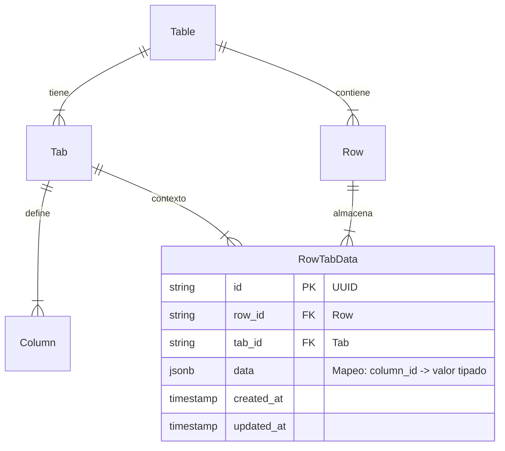

# Migración de CellValue a RowTabData (JSONB por Pestaña)

- Fecha: 2026-11-06
- Estado: completado
- Agentes: `backend`, `db-migration-guard`, `test-writer`, `docker-ops`, `qa`

## Objetivo

Reemplazar la tabla normalizada `CellValue` (patrón EAV) por un modelo desnormalizado por pestaña denominado `RowTabData`. En este nuevo esquema, cada registro representa la intersección única entre una fila (`Row`) y una pestaña (`Tab`), almacenando los valores de todas las columnas de esa pestaña en un campo `JSONField` (`data: {"<column_id>": <valor>}`).

### Beneficios principales

1. **Reducción masiva de registros en BD**: De $O(\text{Filas} \times \text{Columnas})$ a $O(\text{Filas} \times \text{Pestañas})$ (reducción típica de más del 90% de filas en base de datos).
2. **Aislamiento de permisos (Security by Design)**: Los permisos de `django-guardian` se evalúan por `Tab`. La base de datos solo devuelve a Django los datos de la pestaña consultada, evitando transferir celdas de otras pestañas o podar JSONs en memoria.
3. **Lecturas ultrarrápidas en `TabView`**: Pasa de hacer consultas con `JOIN` a miles de celdas y deserialización N+1 a una consulta plana indexada directa.
4. **100% de compatibilidad con el Frontend**: Todos los contratos de respuesta JSON (`TabView`, `CellValueViewSet`, `RowCellValuesView`, `ColumnCellValuesView`) se mantienen idénticos. No se requiere ningún cambio en la SPA de React.

---

## Contexto y archivos relevantes

### Diagrama de la arquitectura objetivo



### Archivos afectados

- `backend/api/models.py`: Declaración de `RowTabData`, utilitarios de validación y retiro de `CellValue`.
- `backend/api/migrations/0013_rowtabdata_migration.py`: Creación de tabla, migración de datos con `RunPython` y eliminación de `cell_values`.
- `backend/api/admin.py`: Registro en Django Admin de `RowTabData`.
- `backend/api/serializers.py`: Adaptación de `RowSerializer` y `CellValueSerializer`.
- `backend/api/views.py`: Adaptación de `TabView`, `CellValueViewSet`, `RowCellValuesView`, `ColumnCellValuesView` y `TableBulkUploadView`.
- `backend/asistencia/views.py`: Adaptación de persistencia de asistencia en `RowTabData`.
- `backend/students/views.py`: Adaptación de guardado de asistencia de estudiantes en `RowTabData`.
- `backend/personal/views.py`: Adaptación de guardado de asistencia y hora de personal en `RowTabData`.
- `backend/api/tests.py`: Pruebas de modelos, endpoints de celdas y vistas asociadas.
- `backend/asistencia/tests.py`: Pruebas del módulo de asistencia.

---

## Decisiones y preguntas resueltas

- **Compatibilidad 100% hacia el Frontend**: Los endpoints `/api/tables/tabview/<table_id>/<tab_id>/`, `/api/tables/cell/<table_id>/<column_id>/<row_id>/`, y `/cellvalues/` mantendrán exactamente las mismas firmas, parámetros, códigos de estado HTTP y formatos JSON de entrada/salida. El frontend de React no sufrirá cambios.
- **Migración de datos históricos**: Se implementará una migración reversible con `RunPython` que agrupa todos los registros existentes en `cell_values` hacia registros `RowTabData` antes de descartar el modelo anterior.
- **Endpoints de celdas individuales**: Se determinó mantener el endpoint `/api/tables/cell/<table_id>/<column_id>/<row_id>/` interactuando de forma transparente contra `RowTabData` para preservar compatibilidad con la SPA y posibles lectores QR externos.

---

## Tareas

| # | Tarea | Agente | Depende de | Criterio de aceptación | Estado |
|---|---|---|---|---|---|
| 1 | Definir modelo `RowTabData` y función utilitaria de validación | `backend` | - | Modelo definido con índices y campos correspondientes en `backend/api/models.py`. | Completado |
| 2 | Crear migración de esquema y transferencia de datos históricos | `backend` | 1 | Migración `0013_rowtabdata_migration.py` con `RunPython` lista. | Completado |
| 3 | Auditar migración de base de datos y riesgo sobre datos existentes | `db-migration-guard` | 2 | Reporte sin bloqueos destructivos no controlados; migración reversible. | Completado |
| 4 | Adaptar serializadores `RowSerializer` y `CellValueSerializer` | `backend` | 1 | Respuestas idénticas a contratos previos manteniendo claves y formatos. | Completado |
| 5 | Adaptar vistas centrales en `backend/api/views.py` | `backend` | 4 | `TabView`, `CellValueViewSet`, `RowCellValuesView`, `ColumnCellValuesView` y `TableBulkUploadView` funcionando sobre `RowTabData`. | Completado |
| 6 | Adaptar submódulos satélite (`asistencia`, `students`, `personal`) | `backend` | 1 | Escrituras de asistencia actualizando correctamente el JSONB de `RowTabData`. | Completado |
| 7 | Actualizar y ampliar tests de backend | `test-writer` | 5, 6 | Suite completa `manage.py test api asistencia students personal` pasando en verde (127 tests). | Completado |
| 8 | Auditoría funcional, de integridad y regresión | `qa` | 7 | Verificación de carga en SPA, edición en línea, modo revisión y checado de asistencia. | Completado |
| 9 | Reconstruir servicio local y aplicar en Docker | `docker-ops` | 8 | Imagen `django` reconstruida y contenedor activo respondiendo 200 OK. | Completado |

---

## Detalle técnico de los cambios propuestos

### Componente 1: Base de Datos y Modelo Core (`backend/api/`)

#### `backend/api/models.py`
- Crear el modelo `RowTabData`:
  ```python
  class RowTabData(models.Model):
      id = models.CharField(max_length=50, primary_key=True, default=uuid.uuid4)
      row = models.ForeignKey(Row, on_delete=models.CASCADE, related_name='tab_data')
      tab = models.ForeignKey(Tab, on_delete=models.CASCADE, related_name='row_data')
      data = models.JSONField(default=dict, blank=True)
      created_at = models.DateTimeField(auto_now_add=True)
      updated_at = models.DateTimeField(auto_now=True)

      class Meta:
          db_table = 'row_tab_data'
          unique_together = [['row', 'tab']]
          indexes = [
              models.Index(fields=['row', 'tab']),
              models.Index(fields=['tab']),
          ]

      def __str__(self):
          return f"RowTabData(row={self.row_id}, tab={self.tab_id})"
  ```
- Crear función utilitaria de validación y formateo de celdas por tipo (`validate_and_format_cell_value(column, value)`).
- Eliminar la clase `CellValue`.

#### `backend/api/migrations/0013_rowtabdata_migration.py`
- Crear la tabla `row_tab_data` con sus índices.
- Operación `RunPython` para transferir los datos desde `cell_values` hacia `row_tab_data`.
- Eliminar la tabla `cell_values`.

#### `backend/api/admin.py`
- Reemplazar el registro de `CellValue` por `RowTabData`.

---

### Componente 2: Serializadores (`backend/api/serializers.py`)

#### `backend/api/serializers.py`
- **`RowSerializer`**:
  - `to_representation(self, instance)`: Reemplazar `instance.cells.all()` por `instance.tab_data.all()`, aplanando las claves en el diccionario `representation['data']`.
  - `_set_cells(self, row, data)`: Agrupar las columnas por su respectivo `tab` y actualizar o crear el registro `RowTabData` correspondiente, guardando `data[column_id] = formatted_value`.
- **`CellValueSerializer`**:
  - Actualizar para que valide y opere contra `RowTabData` o manejar la persistencia manteniendo la firma de salida `{ id, row_id, column_id, value, updated_at }`.

---

### Componente 3: Endpoints de API (`backend/api/views.py`)

#### `backend/api/views.py`
- **`TabView.get`**:
  - Consultar `RowTabData.objects.filter(tab=tab, row_id__in=row_ids)`.
  - Mapear en memoria: `row_data_map = {str(rtd.row_id): rtd.data for rtd in row_tab_records}`.
  - Para cada fila inyectar sus celdas: `r['cells'] = { c['id']: row_data_map.get(r['id'], {}).get(c['id'], None) for c in columns }`.
  - Mantener exactamente la estructura de `pagination`, `columns`, `rows` y `tab`.
- **`CellValueViewSet` (`retrieve`, `create`, `update`, `destroy`)**:
  - Adaptar para que obtenga `tab = column.tab`.
  - Obtener o crear `RowTabData.objects.get_or_create(row=row, tab=tab)`.
  - En `update`/`create`: actualizar `row_tab.data[str(column.id)] = formatted_value` y guardar.
  - En `destroy`: remover `str(column.id)` de `row_tab.data` y guardar.
  - Responder con el mismo contrato esperado por `frontend/src/api/cells.ts`.
- **`RowCellValuesView`**:
  - Reemplazar la búsqueda de `CellValue` por `RowTabData.objects.filter(row=row, tab=tab).first()`.
  - Retornar los valores de las columnas a partir de `rtd.data`.
- **`ColumnCellValuesView`**:
  - Reemplazar la búsqueda de `CellValue` por `RowTabData.objects.filter(tab=column.tab, row__table=table)`.
  - Retornar la lista de filas con sus valores.
- **`TableBulkUploadView`**:
  - Adaptar la creación de celdas para que se agrupen y guarden en `RowTabData`.

---

### Componente 4: Submódulos de Asistencia y Personal

#### `backend/asistencia/views.py`
- Actualizar `check_attendance`:
  - En lugar de `CellValue.objects.get_or_create(...)`, hacer:
    ```python
    rtd, _ = RowTabData.objects.get_or_create(row=relation.row, tab=tab)
    rtd.data[str(column.id)] = True
    rtd.save()
    ```

#### `backend/students/views.py`
- Actualizar la función `check`: guardar `rtd.data[str(column.id)] = True` en `RowTabData`.

#### `backend/personal/views.py`
- Actualizar la función `check`: guardar asistencia y hora en `rtd.data[str(attendance_col.id)] = True` y `rtd.data[str(time_col.id)] = timestamp`.

---

### Componente 5: Tests Automatizados

#### `backend/api/tests.py`
- Adaptar las pruebas unitarias que importan o hacen asserts directos sobre `CellValue` para que usen `RowTabData` y validen los endpoints HTTP de celdas (`/api/tables/cell/...`, `tabview`, etc.).

#### `backend/asistencia/tests.py`
- Adaptar las aserciones de `CellValue` a `RowTabData`.

---

## Riesgos

1. **Pérdida de datos en migración**: Mitigado mediante prueba preliminar del `RunPython` en entorno local y validación con `db-migration-guard` antes de aplicar la migración definitiva.
2. **Concurrencia en actualizaciones sobre el mismo `RowTabData`**: Al guardar varias columnas de una misma fila y pestaña en paralelo, operaciones concurrentes podrían sobreescribir claves si no se gestionan atómicamente. Se evaluará el uso de `F()` / `select_for_update()` en escrituras críticas si se detectan colisiones.
3. **Incompatibilidad con endpoints externos**: Mantener intacto el contrato de `/api/tables/cell/...` y `/cellvalues/` mitiga cualquier ruptura con integraciones existentes.

---

## Documentación a actualizar

- `SYSTEM_API_SPECIFICATION.md`: Sección de arquitectura de base de datos y descripción del modelo `RowTabData`.
- `TODO.md`: Registro del estado de avance de la migración de datos.
- `docs/reports/`: Dictamen emitido por `db-migration-guard`.

---

## Plan de verificación

### Pruebas automatizadas
Ejecutar la suite completa de pruebas en el contenedor Django:
```bash
docker compose exec django python manage.py test api asistencia students personal
```
Criterio de éxito: Todos los tests deben pasar con código de salida `0` (`OK`).

### Verificación manual
1. Abrir la aplicación web SPA en `http://localhost`.
2. Navegar a una tabla existente con pestañas.
3. Verificar que la vista de tabla (`TableView`) carga todas las filas, columnas y celdas sin ningún error visual ni de consola.
4. Editar una celda con el editor en línea (`CellEditor`) y comprobar que el guardado es inmediato y persiste al recargar la página.
5. Probar el "Modo Revisión" (`ReviewMode`) para fila y columna.
6. Realizar un checado de asistencia (por ejemplo, vía POST a `/api/asistencia/check/` o escaneo) y comprobar que se refleja inmediatamente en la pestaña de asistencia de la tabla.
